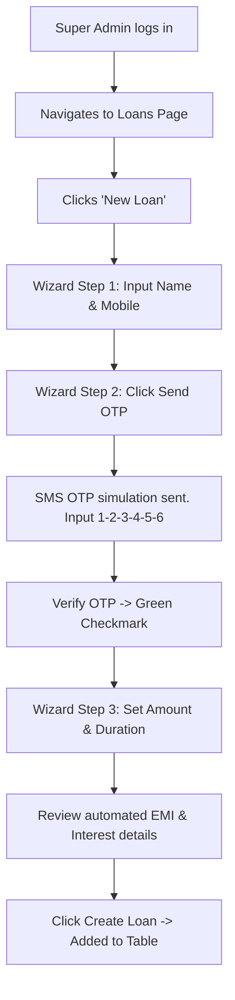
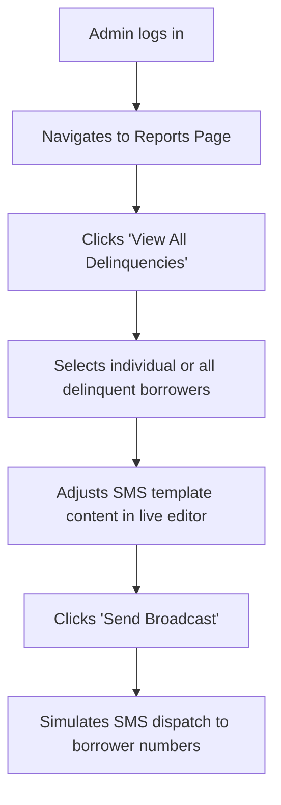

# 🚀 MVP DEFINITION — LoanTracker Pro

**Version:** 2.1  
**Date:** May 2026  
**Status:** ✅ COMPLETE — Production-Ready MVP Architecture

---

## 🎯 MVP Core Objective

To provide a robust, high-performance, and secure Loan Tracking Dashboard for microfinance lenders. The application enables administrators and sub-administrators to manage loan lifecycles, track installments, simulate dynamic interest rate calculations, broadcast SMS delinquencies, and export financial data.

Initially built as a progressive client-only dashboard running entirely in-browser using `localStorage` for rapid verification and zero hosting infrastructure costs, the MVP has been fully designed to migrate seamlessly to a unified PostgreSQL + Node.js/Fastify monolithic backend.

---

## 🔍 MVP Scope

### 1. In-Scope Modules (Core Features)

#### 🔐 Role-Based Access Control (RBAC) & Authentication
* **3-Tier RBAC**: Three predefined user roles with distinct privileges:
  * `SUPER_ADMIN`: Full access including user creation, tab filtering, interest rates, and permission toggling.
  * `ADMIN`: Access to loans, payments, reports, exports, and audit logs.
  * `SUB_ADMIN`: Restricted access limited strictly to viewing/recording loans and payments.
* **Granular Permission Controls**: Allows Super Admins to dynamically toggle permissions (`manage_loans`, `manage_payments`, `export_data`, `view_reports`, `system_config`, `audit_logs`) on a per-user basis.
* **Activation Toggle**: Super Admin can deactivate accounts, preventing login attempts immediately.
* **Settings Access Control**: Filters visible setting tabs according to user roles. Non-super admins only see the personal **Preferences** tab.

#### 📊 Dashboard Analytics
* **Key Metrics**: Dynamic display of Total Loans, Active Loans, Total Disbursed (₹), and Total Collected (₹).
* **Banners & Warnings**: Highlights overdue payments, collections rate (%), and pending payments.
* **Collection Efficiency Graph**: An interactive Spline Area Chart (using ApexCharts) showing expected vs. collected monthly payments across a rolling 12-month period.
* **Status Distribution**: A pie chart showing the percentage breakdown of Active, Closed, Pending, and Defaulted loans.
* **Activity Feeds**: Lists the 5 most recent loans created and the 5 most recent payments logged.

#### 📝 Loan Management (Full CRUD)
* **Loan Wizard**: A 3-step creation flow (Customer Details → OTP Mobile Verification → Loan Parameters Selection).
* **Search & Filters**: Instant full-text search across borrower name, mobile, or loan ID. Filterable by loan status.
* **Sorting**: Multi-column sorting on principal, EMI, start date, duration, and status.
* **Interest & Installment Calculator**: Real-time calculated total repayment and monthly EMI based on duration presets (2 months @ 12.5%, 3 months @ 11%, 6 months @ 9.5%, 12 months @ 8%).

#### 📱 Mobile OTP & Delinquency System
* **Borrower Mobile Verification**: Built-in 6-digit OTP verification wizard simulating AWS SNS SMS delivery (OTP: `123456`) and fallback WhatsApp verification ("Reply YES to verify").
* **Delinquencies Drawer**: Lists all delinquent (overdue) borrowers in a single overlay with search/filters.
* **SMS Broadcast**: Allows customization of overdue notification templates with merge tags (`{{name}}`, `{{amount}}`, `{{due_date}}`) and supports simulated single or bulk SMS broadcast to overdue mobile numbers.

#### 💳 Payments & Schedule Log
* **EMI Schedule**: Displays chronological logs of installments, due dates, paid dates, and statuses (Pending, Paid, Overdue).
* **Payment Recording**: Standardized modal to record payment amounts against active loans, updating installment states dynamically.
* **Auto-Status Upgrades**: Automatically sets loans to `ACTIVE` upon first payment, and upgrades to `CLOSED` once all scheduled installments are fully cleared.

#### 📂 Data Export Engine
* **File Formats**: High-speed toggling between CSV and JSON formatting.
* **Advanced Filters**: Filters records by custom start/end date range and status.
* **Code Preview & Clipboard**: Renders syntax-highlighted previews of export payloads and supports one-click copying to clipboard.
* **Download Trigger**: Triggers browser file downloads (e.g. `loans_export_2026-05-26.csv`).

---

### 2. Out-of-Scope (Deferred to Monolithic Backend Integration)
* **Real SMS Gateway Integration**: True AWS SNS/Twilio API hooks are bypassed in the frontend client and simulated with client timers (30s cooldowns).
* **WhatsApp Business Webhooks**: Production webhook receivers are simulated using a 3-second auto-resolve timer.
* **Real-time Audit Logs Database**: Renders logs in local state rather than pushing to a persistent, immutable append-only data store.
* **Customer Payment Portals**: Interface is strictly internal/administrative. Direct borrower-facing portals are deferred.

---

## 🚀 MVP User Journeys

### Journey 1: Create a Verified Loan

### Journey 2: Broadcast Delinquency SMS Alerts

---

## 🛠️ MVP Technical Constraints

| Metric / Parameter | Value / Target | Current Implementation |
|--------------------|----------------|------------------------|
| **Deployment Mode**| Single-File HTML / PWA | Vite inlines CSS, JS, and SVG assets into a single static output (`dist/index.html`) using `vite-plugin-singlefile` |
| **Gzipped Bundle Size** | < 750 KB | Compiled bundle size is **~268 KB** |
| **Database Persistence** | Offline First | Structured JSON schemas stored in client-side `localStorage` (`loantracker_loans`, `loantracker_payments`, `loantracker_accounts`, etc.) |
| **Styling Engine** | Utility CSS | Vanilla Tailwind CSS (v4.0) with an atomic design system |
| **External Dependencies** | 0 Remote API calls | Fully self-contained. Charts are generated locally using Recharts and ApexCharts |
