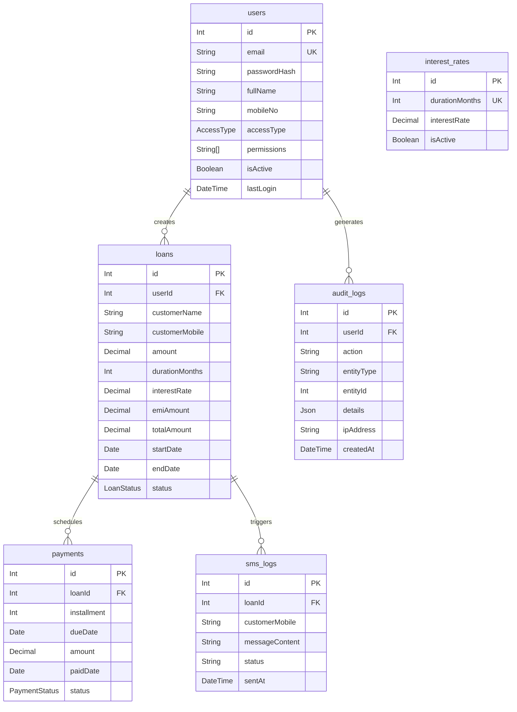

# 🗄️ BACKEND DATABASE SCHEMA — LoanTracker Pro

**Version:** 2.1  
**Date:** May 2026  
**Database:** PostgreSQL (via Prisma ORM)  
**Status:** Production-Ready

---

## 📋 Overview

LoanTracker Pro uses a **PostgreSQL** relational database managed via **Prisma ORM**. The schema is organized into 6 core models covering users, loans, payments, SMS communication, interest rate configuration, and audit logging.

---

## 🔠 Enums

### `AccessType`
Defines the role-based hierarchy for system users.

| Value | Description |
|-------|-------------|
| `SUPER_ADMIN` | Full system access including user management, configuration, and all modules |
| `ADMIN` | Access to loans, payments, reports, exports, and audit logs |
| `SUB_ADMIN` | Restricted to viewing and recording loans and payments only |

---

### `LoanStatus`
Tracks the lifecycle state of a loan.

| Value | Description |
|-------|-------------|
| `PENDING` | Loan created but no payment received yet |
| `ACTIVE` | First installment recorded; loan is in repayment |
| `CLOSED` | All installments fully paid |
| `DEFAULT` | Borrower has missed payments and is in default |

---

### `PaymentStatus`
Tracks the state of each installment.

| Value | Description |
|-------|-------------|
| `PENDING` | Installment due date has not yet passed |
| `PAID` | Payment has been recorded |
| `OVERDUE` | Due date has passed with no payment received |

---

### `LogActionType`
Enum of auditable system events (stored as `String` in `AuditLog.action`).

| Value | Triggered When |
|-------|----------------|
| `CREATE_USER` | A new user account is created |
| `UPDATE_USER` | User details or permissions are modified |
| `DEACTIVATE_USER` | A user account is toggled inactive |
| `CREATE_LOAN` | A new loan is successfully created |
| `UPDATE_LOAN_STATUS` | Loan status is manually changed |
| `RECORD_PAYMENT` | A payment installment is recorded |
| `UPDATE_INTEREST_RATES` | Interest rate configuration is changed |
| `EXPORT_DATA` | A data export is triggered |
| `SMS_BROADCAST` | Bulk or single SMS is dispatched |

---

## 📊 Database Tables (Models)

### 1. `users` — System Users & Administrators

Stores all internal staff accounts with role, permissions, and activity metadata.

| Column | Type | Constraints | Description |
|--------|------|-------------|-------------|
| `id` | `Int` | PK, auto-increment | Unique user identifier |
| `email` | `String` | UNIQUE, NOT NULL | Login email address |
| `passwordHash` | `String` | NOT NULL | bcrypt-hashed password |
| `fullName` | `String` | NOT NULL | Display name |
| `mobileNo` | `String` | NOT NULL | Staff contact number |
| `accessType` | `AccessType` | Default: `SUB_ADMIN` | Role/tier assignment |
| `department` | `String` | Default: `"Operations"` | Organizational department |
| `permissions` | `String[]` | Default: `[]` | Granular feature permissions |
| `isActive` | `Boolean` | Default: `true` | Account active state |
| `loginCount` | `Int` | Default: `0` | Total login count |
| `lastLogin` | `DateTime?` | Nullable | Timestamp of most recent login |
| `twoFactorEnabled` | `Boolean` | Default: `false` | 2FA status flag |
| `createdAt` | `DateTime` | Default: `now()` | Record creation timestamp |
| `updatedAt` | `DateTime` | Auto-updated | Last modification timestamp |

**Relations:**
- `loans` → `Loan[]` (one-to-many; loans created by this user)
- `auditLogs` → `AuditLog[]` (one-to-many; actions performed by this user)

**Granular Permissions (stored in `permissions[]`):**

| Permission Key | Controls |
|----------------|----------|
| `manage_loans` | Create, view, and update loans |
| `manage_payments` | Record payment installments |
| `export_data` | Download CSV/JSON exports |
| `view_reports` | Access the Reports module |
| `system_config` | Edit interest rates and app preferences |
| `audit_logs` | View the audit log trail |

---

### 2. `loans` — Loan Records

Core financial entity. Each row represents a single borrower loan with full repayment metadata.

| Column | Type | Constraints | Description |
|--------|------|-------------|-------------|
| `id` | `Int` | PK, auto-increment | Unique loan identifier |
| `userId` | `Int?` | FK → `users.id`, Nullable | Staff member who created the loan |
| `customerName` | `String` | NOT NULL | Full name of the borrower |
| `customerMobile` | `String` | NOT NULL | Borrower's verified mobile number |
| `mobileVerified` | `Boolean` | Default: `false` | OTP verification flag |
| `verificationToken` | `String?` | Nullable | Redis-validated OTP token |
| `amount` | `Decimal(12,2)` | NOT NULL | Principal disbursed amount (₹) |
| `durationMonths` | `Int` | NOT NULL | Loan term (2, 3, 6, or 12 months) |
| `interestRate` | `Decimal(5,2)` | NOT NULL | Rate applied at loan creation — uses custom override if provided, otherwise resolved from `interest_rates` table |
| `emiAmount` | `Decimal(12,2)` | NOT NULL | Monthly installment amount (₹) |
| `totalAmount` | `Decimal(12,2)` | NOT NULL | Total repayable (principal + interest) |
| `startDate` | `Date` | NOT NULL | Loan disbursement date |
| `endDate` | `Date` | NOT NULL | Final installment due date |
| `status` | `LoanStatus` | Default: `PENDING` | Current loan lifecycle state |
| `createdAt` | `DateTime` | Default: `now()` | Record creation timestamp |
| `updatedAt` | `DateTime` | Auto-updated | Last modification timestamp |

**Indexes:**
- `@@index([status])` — Fast filtering by loan status
- `@@index([customerMobile])` — Fast mobile number lookups

**Relations:**
- `user` → `User?` (many-to-one; creator of the loan)
- `payments` → `Payment[]` (one-to-many; installment schedule)
- `smsLogs` → `SmsLog[]` (one-to-many; sent SMS records)

**EMI Calculation Formula (Compound Monthly):**
```
monthlyRate  = annualInterestRate / 12 / 100
emiAmount    = principal × monthlyRate × (1 + monthlyRate)^n
               ─────────────────────────────────────────────
                       (1 + monthlyRate)^n − 1

totalAmount  = emiAmount × durationMonths
```
> This is the standard reducing-balance compound formula — the same used in `calculateEMI()` in `src/data/mockData.ts`.

**Custom Interest Rate Override:**  
When creating a loan, a `customInterestRate` can be supplied in the request body. If present, it takes priority over the `interest_rates` table lookup. This allows per-loan negotiated rates (e.g., special schemes, collateral-backed discounts). The resolved rate — whether default or custom — is always stored in `loans.interestRate` for immutability.

**Default Interest Rate Presets:**

| Duration | Default Rate | Can Override? |
|----------|-------------|---------------|
| 2 months | 12.5% | ✅ Yes |
| 3 months | 11.0% | ✅ Yes |
| 6 months | 9.5% | ✅ Yes |
| 12 months | 8.0% | ✅ Yes |

---

### 3. `payments` — Installment Schedule & Records

Each row is a single EMI installment. A loan with `durationMonths = 6` generates exactly 6 payment rows.

| Column | Type | Constraints | Description |
|--------|------|-------------|-------------|
| `id` | `Int` | PK, auto-increment | Unique payment identifier |
| `loanId` | `Int` | FK → `loans.id`, Cascade Delete | Parent loan reference |
| `installment` | `Int` | NOT NULL | Installment number (1-based) |
| `dueDate` | `Date` | NOT NULL | Expected payment date |
| `amount` | `Decimal(12,2)` | NOT NULL | EMI amount due (₹) |
| `paidDate` | `Date?` | Nullable | Actual payment received date |
| `status` | `PaymentStatus` | Default: `PENDING` | Current installment state |
| `createdAt` | `DateTime` | Default: `now()` | Record creation timestamp |
| `updatedAt` | `DateTime` | Auto-updated | Last modification timestamp |

**Unique Constraint:**
- `@@unique([loanId, installment])` — Each installment number is unique per loan

**Indexes:**
- `@@index([status])` — Fast overdue/pending queries
- `@@index([dueDate])` — Fast date range filters for reports

**Auto-Status Logic (handled at application layer):**
- First payment recorded → parent `Loan.status` updated to `ACTIVE`
- All installments `PAID` → parent `Loan.status` updated to `CLOSED`

---

### 4. `sms_logs` — SMS Dispatch Records

Immutable log of all SMS messages sent to borrowers (delinquency alerts, OTP, broadcasts).

| Column | Type | Constraints | Description |
|--------|------|-------------|-------------|
| `id` | `Int` | PK, auto-increment | Unique log entry identifier |
| `loanId` | `Int?` | FK → `loans.id`, Nullable, Cascade Delete | Associated loan (if applicable) |
| `customerMobile` | `String` | NOT NULL | Recipient phone number |
| `messageContent` | `String` | NOT NULL | Full text of the SMS sent |
| `status` | `String` | NOT NULL | `"SENT"` or `"FAILED"` |
| `sentAt` | `DateTime` | Default: `now()` | Dispatch timestamp |

**Notes:**
- `loanId` is nullable to support non-loan-specific messages (e.g., system alerts)
- Records are append-only; no updates are made after insertion

---

### 5. `interest_rates` — Rate Configuration

Configurable lookup table for duration-based interest rates. Allows Super Admin to update rates without code changes.

| Column | Type | Constraints | Description |
|--------|------|-------------|-------------|
| `id` | `Int` | PK, auto-increment | Unique rate entry identifier |
| `durationMonths` | `Int` | UNIQUE, NOT NULL | Loan term (must be unique) |
| `interestRate` | `Decimal(5,2)` | NOT NULL | Annual/flat interest rate (%) |
| `isActive` | `Boolean` | Default: `true` | Whether this rate is available |
| `createdAt` | `DateTime` | Default: `now()` | Record creation timestamp |
| `updatedAt` | `DateTime` | Auto-updated | Last modification timestamp |

**Seed Data:**

```sql
INSERT INTO interest_rates (durationMonths, interestRate) VALUES
  (2, 12.5),
  (3, 11.0),
  (6, 9.5),
  (12, 8.0);
```

> **Note:** These are default rates only. Individual loans can override them with a custom `interestRate` passed at creation time. The `interest_rates` table is the fallback — not a hard constraint.

---

### 6. `audit_logs` — Immutable Activity Trail

Append-only record of all significant actions performed in the system for compliance and debugging.

| Column | Type | Constraints | Description |
|--------|------|-------------|-------------|
| `id` | `Int` | PK, auto-increment | Unique log entry identifier |
| `userId` | `Int?` | FK → `users.id`, Nullable, `SetNull` | Actor who performed the action |
| `action` | `String` | NOT NULL | Action type (from `LogActionType` enum values) |
| `entityType` | `String` | NOT NULL | Target resource type (`"loan"`, `"payment"`, `"user"`, `"config"`) |
| `entityId` | `Int?` | Nullable | ID of the affected resource |
| `details` | `Json?` | Nullable | Structured metadata about the change |
| `ipAddress` | `String?` | Nullable | Requestor IP address |
| `createdAt` | `DateTime` | Default: `now()` | Timestamp of the action |

**Notes:**
- No `updatedAt` column — records are never modified
- `userId` uses `SetNull` on delete to preserve logs even if the user account is removed

---

## 🔗 Entity Relationship Diagram



---

## 🔐 Redis Cache Schema

Redis is used for ephemeral session and OTP data with TTL expiration — **not** persisted to PostgreSQL.

| Key Pattern | Value | TTL | Purpose |
|-------------|-------|-----|---------|
| `session:{userId}` | JWT refresh token string | 7 days | User session management |
| `verified:{mobile}` | OTP verification token | 10 minutes | Mobile OTP validation for loan creation |
| `otp:{mobile}` | 6-digit OTP code | 5 minutes | Active OTP for verification |
| `cooldown:{mobile}` | Timestamp | 30 seconds | OTP resend rate limiter |

---

## 🌐 API Response Envelope

All backend endpoints return a consistent JSON structure:

```typescript
interface ApiResponse<T> {
  success: boolean;
  data?: T;
  error?: string;
  pagination?: {
    total: number;
    page: number;
    limit: number;
    totalPages: number;
  };
}
```

**HTTP Status Codes:**

| Code | Meaning |
|------|---------|
| `200` | OK — successful GET/PUT |
| `201` | Created — successful POST |
| `400` | Bad Request — validation error |
| `401` | Unauthorized — missing/invalid JWT |
| `403` | Forbidden — insufficient permissions |
| `404` | Not Found — resource does not exist |
| `429` | Too Many Requests — rate limit exceeded |
| `500` | Internal Server Error |

---

## 🛠️ Environment Variables Reference

| Variable | Required | Description |
|----------|----------|-------------|
| `PORT` | No (default: `3000`) | Server listen port |
| `NODE_ENV` | No (default: `development`) | Runtime environment |
| `DATABASE_URL` | **Yes** | PostgreSQL connection string |
| `REDIS_URL` | **Yes** | Redis connection string |
| `JWT_SECRET` | **Yes** | Access token signing key (min 32 chars) |
| `JWT_REFRESH_SECRET` | **Yes** | Refresh token signing key (min 32 chars) |
| `AWS_REGION` | No (default: `ap-south-1`) | AWS region for SNS |
| `AWS_ACCESS_KEY_ID` | No | AWS credentials for SMS |
| `AWS_SECRET_ACCESS_KEY` | No | AWS credentials for SMS |
| `AWS_SNS_SENDER_ID` | No (default: `LNTRACK`) | SMS sender ID |
| `WHATSAPP_PHONE_NUMBER_ID` | No | WhatsApp Business phone ID |
| `WHATSAPP_ACCESS_TOKEN` | No | WhatsApp API access token |
