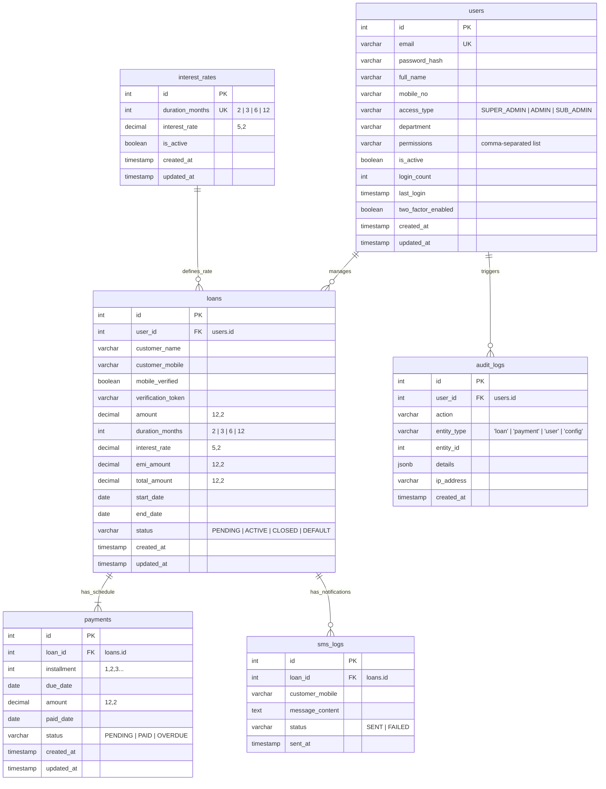
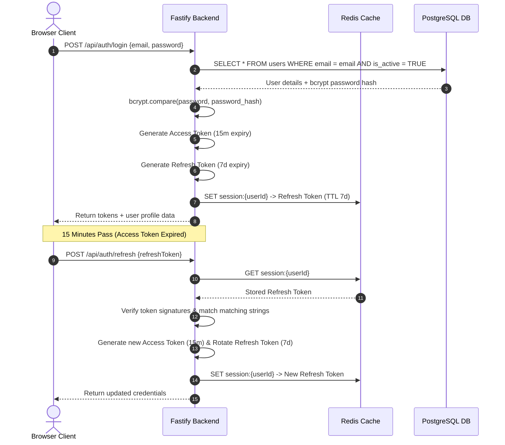
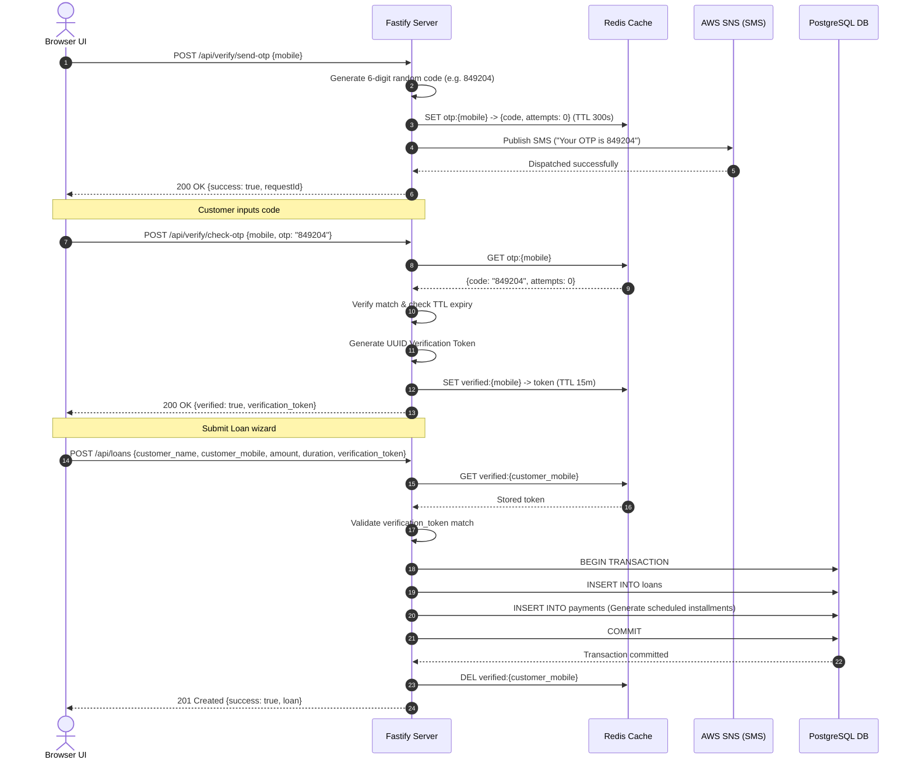
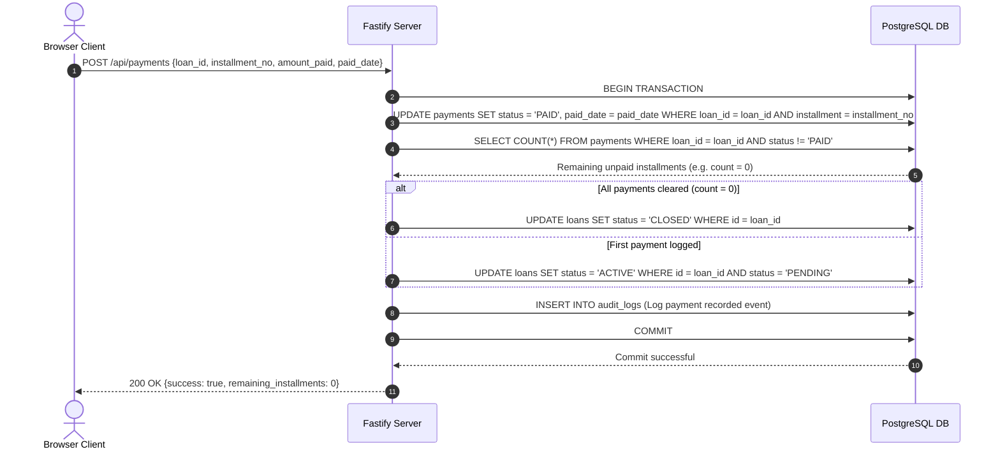

# 📐 SYSTEM DESIGN SPECIFICATIONS — LoanTracker Pro

**Version:** 2.1  
**Date:** May 2026  
**Status:** Monolithic Migration Blueprint

---

## 📊 1. Data Modeling & Database Schema (PostgreSQL)

The database architecture is designed for a relational PostgreSQL database to ensure strict ACID transactions, data integrity, and complex relational querying (e.g., matching payments, loans, and audit trails).

### 🧬 Entity-Relationship Diagram (ERD)



### 🗄️ SQL Schema Definitions (With Indexes & Check Constraints)

```sql
-- Enums & Extensions
CREATE EXTENSION IF NOT EXISTS "uuid-ossp";

-- 1. Users Table (Rbac Roles & Authentication)
CREATE TABLE users (
  id            SERIAL PRIMARY KEY,
  email         VARCHAR(255) UNIQUE NOT NULL,
  password_hash VARCHAR(255) NOT NULL,
  full_name     VARCHAR(100) NOT NULL,
  mobile_no     VARCHAR(20) NOT NULL,
  access_type   VARCHAR(20) NOT NULL DEFAULT 'SUB_ADMIN'
                CHECK (access_type IN ('SUPER_ADMIN', 'ADMIN', 'SUB_ADMIN')),
  department    VARCHAR(100) NOT NULL DEFAULT 'Operations',
  permissions   TEXT[] NOT NULL DEFAULT '{}',
  is_active     BOOLEAN NOT NULL DEFAULT TRUE,
  login_count   INT NOT NULL DEFAULT 0,
  last_login    TIMESTAMP,
  two_factor_enabled BOOLEAN NOT NULL DEFAULT FALSE,
  created_at    TIMESTAMP NOT NULL DEFAULT CURRENT_TIMESTAMP,
  updated_at    TIMESTAMP NOT NULL DEFAULT CURRENT_TIMESTAMP
);

CREATE INDEX idx_users_email ON users(email);
CREATE INDEX idx_users_access_type ON users(access_type);

-- 2. Interest Rates Configuration Table
CREATE TABLE interest_rates (
  id              SERIAL PRIMARY KEY,
  duration_months INT UNIQUE NOT NULL CHECK (duration_months > 0),
  interest_rate   DECIMAL(5,2) NOT NULL CHECK (interest_rate >= 0.00),
  is_active       BOOLEAN NOT NULL DEFAULT TRUE,
  created_at      TIMESTAMP NOT NULL DEFAULT CURRENT_TIMESTAMP,
  updated_at      TIMESTAMP NOT NULL DEFAULT CURRENT_TIMESTAMP
);

-- Seed defaults
INSERT INTO interest_rates (duration_months, interest_rate) VALUES
  (2, 12.50), (3, 11.00), (6, 9.50), (12, 8.00);

-- 3. Loans Table
CREATE TABLE loans (
  id              SERIAL PRIMARY KEY,
  user_id         INT REFERENCES users(id) ON DELETE SET NULL,
  customer_name   VARCHAR(100) NOT NULL,
  customer_mobile VARCHAR(20) NOT NULL,
  mobile_verified BOOLEAN NOT NULL DEFAULT FALSE,
  verification_token VARCHAR(255),
  amount          DECIMAL(12,2) NOT NULL CHECK (amount > 0.00),
  duration_months INT REFERENCES interest_rates(duration_months),
  interest_rate   DECIMAL(5,2) NOT NULL,
  emi_amount      DECIMAL(12,2) NOT NULL CHECK (emi_amount > 0.00),
  total_amount    DECIMAL(12,2) NOT NULL CHECK (total_amount > 0.00),
  start_date      DATE NOT NULL,
  end_date        DATE NOT NULL,
  status          VARCHAR(20) NOT NULL DEFAULT 'PENDING'
                  CHECK (status IN ('PENDING', 'ACTIVE', 'CLOSED', 'DEFAULT')),
  created_at      TIMESTAMP NOT NULL DEFAULT CURRENT_TIMESTAMP,
  updated_at      TIMESTAMP NOT NULL DEFAULT CURRENT_TIMESTAMP
);

CREATE INDEX idx_loans_status ON loans(status);
CREATE INDEX idx_loans_customer_mobile ON loans(customer_mobile);
CREATE INDEX idx_loans_user_id ON loans(user_id);

-- 4. Payments Table (EMI Schedule Tracking)
CREATE TABLE payments (
  id          SERIAL PRIMARY KEY,
  loan_id     INT NOT NULL REFERENCES loans(id) ON DELETE CASCADE,
  installment INT NOT NULL CHECK (installment > 0),
  due_date    DATE NOT NULL,
  amount      DECIMAL(12,2) NOT NULL CHECK (amount > 0.00),
  paid_date   DATE,
  status      VARCHAR(20) NOT NULL DEFAULT 'PENDING'
              CHECK (status IN ('PENDING', 'PAID', 'OVERDUE')),
  created_at  TIMESTAMP NOT NULL DEFAULT CURRENT_TIMESTAMP,
  updated_at  TIMESTAMP NOT NULL DEFAULT CURRENT_TIMESTAMP,
  UNIQUE(loan_id, installment)
);

CREATE INDEX idx_payments_loan_id ON payments(loan_id);
CREATE INDEX idx_payments_status ON payments(status);
CREATE INDEX idx_payments_due_date ON payments(due_date);

-- 5. SMS Notification Logs Table
CREATE TABLE sms_logs (
  id              SERIAL PRIMARY KEY,
  loan_id         INT REFERENCES loans(id) ON DELETE CASCADE,
  customer_mobile VARCHAR(20) NOT NULL,
  message_content TEXT NOT NULL,
  status          VARCHAR(20) NOT NULL CHECK (status IN ('SENT', 'FAILED')),
  sent_at         TIMESTAMP NOT NULL DEFAULT CURRENT_TIMESTAMP
);

CREATE INDEX idx_sms_logs_loan_id ON sms_logs(loan_id);

-- 6. Audit Trail Logs Table (Compliance & Security)
CREATE TABLE audit_logs (
  id          SERIAL PRIMARY KEY,
  user_id     INT REFERENCES users(id) ON DELETE SET NULL,
  action      VARCHAR(100) NOT NULL,
  entity_type VARCHAR(50) NOT NULL, -- 'loan', 'payment', 'user', 'config'
  entity_id   INT,
  details     JSONB,
  ip_address  VARCHAR(45),
  created_at  TIMESTAMP NOT NULL DEFAULT CURRENT_TIMESTAMP
);

CREATE INDEX idx_audit_logs_created_at ON audit_logs(created_at);
CREATE INDEX idx_audit_logs_entity ON audit_logs(entity_type, entity_id);
```

---

## 📡 2. API Design & Endpoint Specifications

### Authentication API

#### `POST /api/auth/login`
Authenticates a user via email and password, returning access & refresh tokens.
* **Request Body**:
  ```json
  {
    "email": "rajesh.sharma@loantracker.pro",
    "password": "adminpassword123"
  }
  ```
* **Success Response (200 OK)**:
  ```json
  {
    "accessToken": "eyJhbGciOiJI...",
    "refreshToken": "eyJhbGciOiJI...",
    "user": {
      "id": 1,
      "email": "rajesh.sharma@loantracker.pro",
      "full_name": "Rajesh Sharma",
      "access_type": "SUPER_ADMIN",
      "department": "Risk Management & Compliance",
      "permissions": ["all", "manage_users", "manage_loans", "manage_payments", "export_data", "view_reports", "system_config", "audit_logs"]
    }
  }
  ```

---

### Loans API

#### `GET /api/loans`
Retrieves a paginated list of loans with optional search and filters.
* **Query Parameters**:
  * `page` (default: 1)
  * `limit` (default: 10)
  * `search` (optional search term)
  * `status` (PENDING, ACTIVE, CLOSED, DEFAULT)
* **Success Response (200 OK)**:
  ```json
  {
    "loans": [
      {
        "id": 12,
        "customer_name": "Rahul Gupta",
        "customer_mobile": "+919876543210",
        "amount": 75000.00,
        "emi_amount": 13075.00,
        "duration_months": 6,
        "interest_rate": 9.50,
        "status": "ACTIVE",
        "start_date": "2026-05-26"
      }
    ],
    "pagination": {
      "total": 45,
      "page": 1,
      "limit": 10,
      "totalPages": 5
    }
  }
  ```

#### `POST /api/loans`
Creates a new loan record. Requires a valid verification token generated by the OTP wizard.
* **Request Body**:
  ```json
  {
    "customer_name": "Rahul Gupta",
    "customer_mobile": "+919876543210",
    "amount": 75000.00,
    "duration_months": 6,
    "verification_token": "tok_otp_verified_9dd5a360"
  }
  ```
* **Success Response (210 Created)**:
  ```json
  {
    "success": true,
    "loan": {
      "id": 13,
      "customer_name": "Rahul Gupta",
      "customer_mobile": "+919876543210",
      "amount": 75000.00,
      "interest_rate": 9.50,
      "emi_amount": 13075.00,
      "total_amount": 78450.00,
      "status": "PENDING"
    }
  }
  ```

---

### OTP & Verification API

#### `POST /api/verify/send-otp`
Triggers a random 6-digit OTP SMS via AWS SNS.
* **Request Body**:
  ```json
  {
    "mobile": "+919876543210"
  }
  ```
* **Success Response (200 OK)**:
  ```json
  {
    "success": true,
    "requestId": "sns_req_7829a28c"
  }
  ```

#### `POST /api/verify/check-otp`
Validates the input code against the Redis OTP cache.
* **Request Body**:
  ```json
  {
    "mobile": "+919876543210",
    "otp": "123456"
  }
  ```
* **Success Response (200 OK)**:
  ```json
  {
    "verified": true,
    "verification_token": "tok_otp_verified_9dd5a360"
  }
  ```

---

## 🔄 3. Sequence Diagrams

### 🔐 Journey 1: User Authentication & JWT Rotation



### 📱 Journey 2: Loan Creation with 2-Step OTP Verification



### 💳 Journey 3: EMI Repayment Logging & Automated Status Lifecycle



---

## ⚡ 4. Caching & Redis Infrastructure Strategy

Redis is utilized as a high-speed in-memory caching and session key-value store to shield the primary database from read spikes and manage volatile state (like OTP tokens).

| Key Prefix | Value Data Structure | TTL | Invalidation Trigger |
|------------|----------------------|-----|----------------------|
| `session:{userId}` | JWT Refresh Token String | 7 Days (604,800s) | Replaced on JWT rotation; deleted on explicit user logout. |
| `otp:{mobile}` | `{ "code": "849204", "attempts": 0 }` | 5 Minutes (300s) | Deleted immediately upon successful verification. |
| `verified:{mobile}`| Verification UUID Token String | 15 Minutes (900s) | Deleted upon completion of `POST /api/loans`. |
| `interest_rates` | JSON Object (Duration to Interest mapping) | 24 Hours (86,400s) | Flushed when Super Admin updates interest rates in Settings. |
| `loans:list` | JSON Array (Latest 50 active loans) | 5 Minutes (300s) | Invalidated/deleted when a new loan is created or updated. |

---

## 🔐 5. Production Security Control Matrix

* **Transport Layer Security**: SSL/TLS 1.3 encryption terminates at the Load Balancer with absolute HTTPS redirection configured for Port 80.
* **Authentication Security**: 
  * Passwords hashed using `bcrypt` with `10` salt rounds.
  * Access tokens expire in 15 minutes; refresh tokens use rotation mechanics to block replay exploits.
  * IP-based rate limiting limits attempts to 5 failed logins per minute.
* **Network & Database Shield**:
  * PostgreSQL database hosted inside a private isolated subnet within a VPC, blocking public ingress.
  * All queries parameterized (via Prisma/TypeORM) to isolate database from SQL-injection vulnerabilities.
* **Compliance Audit Logs**: All actions regarding user creations, permission changes, rate configurations, and payment updates are written immediately to `audit_logs` as non-destructible append-only events.
