# 🔄 USER FLOWS — LoanTracker Pro

**Version:** 2.1  
**Date:** May 2026  
**Status:** Production-Ready MVP Flows

---

## 📋 Overview

This document covers all primary user journeys across the LoanTracker Pro backend system — from authentication to loan lifecycle management, payment recording, SMS broadcasts, and administrative configuration. Flows are mapped per role and annotated with API endpoints.

---

## 👥 Role Reference

| Role | Capabilities |
|------|-------------|
| **SUPER_ADMIN** | All actions: user management, config, all modules |
| **ADMIN** | Loans, payments, reports, exports, audit logs |
| **SUB_ADMIN** | View and record loans/payments only |

---

## 1. 🔐 Authentication Flows

### 1.1 User Login

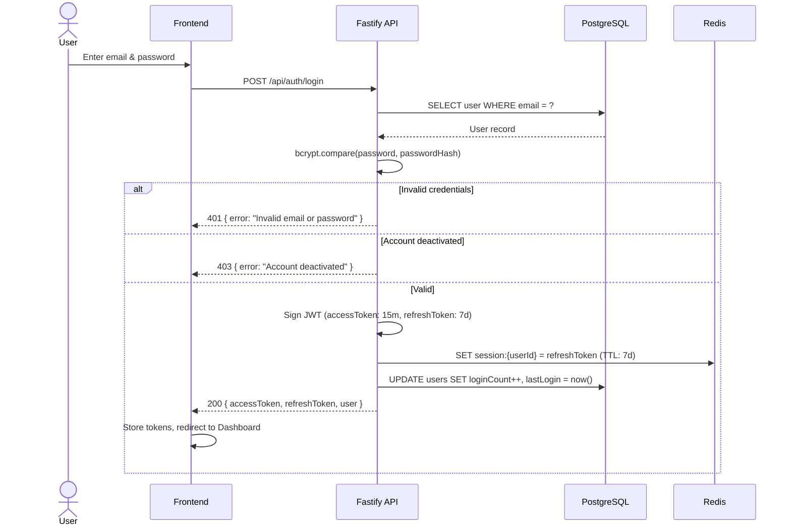

**Endpoint:** `POST /api/auth/login`  
**Request Body:**
```json
{ "email": "admin@loantracker.in", "password": "securepass123" }
```
**Success Response:**
```json
{
  "accessToken": "eyJ...",
  "refreshToken": "eyJ...",
  "user": {
    "id": 1,
    "email": "admin@loantracker.in",
    "full_name": "Rohit Sharma",
    "access_type": "ADMIN",
    "department": "Operations",
    "permissions": ["manage_loans", "manage_payments", "view_reports"]
  }
}
```

---

### 1.2 User Logout

```mermaid
flowchart LR
    A[User clicks Logout] --> B["POST /api/auth/logout\n(Bearer token in header)"]
    B --> C[Verify JWT]
    C --> D["DELETE session:{userId} from Redis"]
    D --> E[200 { success: true }]
    E --> F[Frontend clears tokens\nRedirect to Login]
```

**Endpoint:** `POST /api/auth/logout`  
**Headers:** `Authorization: Bearer <accessToken>`

---

## 2. 📝 Loan Management Flows

### 2.1 Create Loan — 3-Step Wizard

```mermaid
flowchart TD
    A([Start: ADMIN or SUPER_ADMIN]) --> B

    subgraph STEP1 ["Step 1 — Customer Details"]
        B[Enter Customer Name & Mobile] --> C{Mobile already\nexists in DB?}
        C -->|New Customer| D[Proceed to Step 2]
        C -->|Existing Customer| E[Show existing loan\nwarning modal]
        E --> D
    end

    subgraph STEP2 ["Step 2 — Mobile OTP Verification"]
        D --> F["POST /api/verify/send-otp\n(mobile number)"]
        F --> G["AWS SNS sends 6-digit OTP\nOTP saved in Redis\nTTL: 5 minutes"]
        G --> H[User enters OTP in UI]
        H --> I["POST /api/verify/verify-otp\n(mobile, otp)"]
        I --> J{OTP valid\n& not expired?}
        J -->|Invalid / Expired| K[Show error\nAllow Resend after 30s]
        K --> H
        J -->|Valid| L["Redis: SET verified:{mobile} = token\nTTL: 10 minutes"]
        L --> M[✅ Verified — Proceed to Step 3]
    end

    subgraph STEP3 ["Step 3 — Loan Parameters"]
        M --> N[Select Loan Amount & Duration]
        N --> O["UI auto-calculates EMI & Total Amount\nbased on default rate from InterestRate table"]
        O --> O2{Override with\ncustom rate?}
        O2 -->|No| P["Use default rate from interest_rates table\n(e.g. 9.5% for 6 months)"]
        O2 -->|Yes| P2["Agent enters custom rate % p.a.\n(e.g. 7.5% for special scheme)"]
        P & P2 --> P3["EMI live-preview updates:\nemiAmount = principal × r(1+r)^n / ((1+r)^n−1)"]
        P3 --> Q[User confirms & clicks Create Loan]
        Q --> R["POST /api/loans\n{ customerName, customerMobile,\n  amount, durationMonths, verificationToken,\n  customInterestRate? (optional) }"]
        R --> S{Verified token\nvalid in Redis?}
        S -->|Not found / Mismatch| T[400 — Mobile must be re-verified]
        S -->|Valid| U["Resolve interest rate:\ncustomInterestRate ?? InterestRate table lookup"]
        U --> V["DB Transaction:\n1. INSERT loan (with resolved rate stored immutably)\n2. INSERT payment schedule (N installments)\n3. DELETE verified:{mobile} from Redis"]
        V --> W[201 { success: true, loan }]
        W --> X([Loan created & appears in table])
    end
```

**Endpoints:**
| Step | Method | Path | Permission |
|------|--------|------|------------|
| Send OTP | `POST` | `/api/verify/send-otp` | `manage_loans` |
| Verify OTP | `POST` | `/api/verify/verify-otp` | `manage_loans` |
| Create Loan | `POST` | `/api/loans` | `manage_loans` |

**Create Loan Request Body:**
```json
{
  "customerName": "Priya Singh",
  "customerMobile": "9876543210",
  "amount": 500000,
  "durationMonths": 6,
  "verificationToken": "uuid-from-redis",
  "customInterestRate": 7.5
}
```
> `customInterestRate` is **optional**. When omitted, the rate is resolved from the `interest_rates` table (e.g. `9.5%` for 6 months). When provided, it overrides the default and is stored immutably on the loan record.

---

### 2.4 Custom Interest Rate Resolution Logic

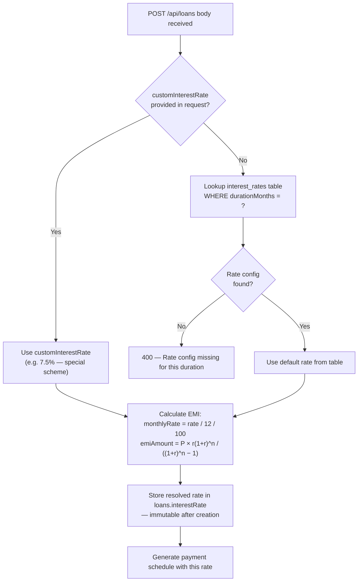

**Key Rules:**
- The resolved rate (custom or default) is **always stored** on `loans.interestRate` at creation time — it never changes even if the admin later updates the `interest_rates` table.
- There is **no min/max cap** enforced at the DB level — validation should be applied in the API layer (e.g. `zod`: `z.number().min(1).max(50)`).
- Only users with `manage_loans` permission (or `SUPER_ADMIN`) can create loans with custom rates.
- Custom rates are visible in the Loans table under the **Rate** column and in the loan detail modal.

---

### 2.2 List & Search Loans

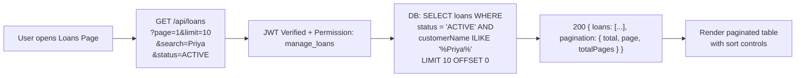

**Endpoint:** `GET /api/loans`  
**Query Params:** `page`, `limit`, `search` (name/mobile), `status`

---

### 2.3 Update Loan Status

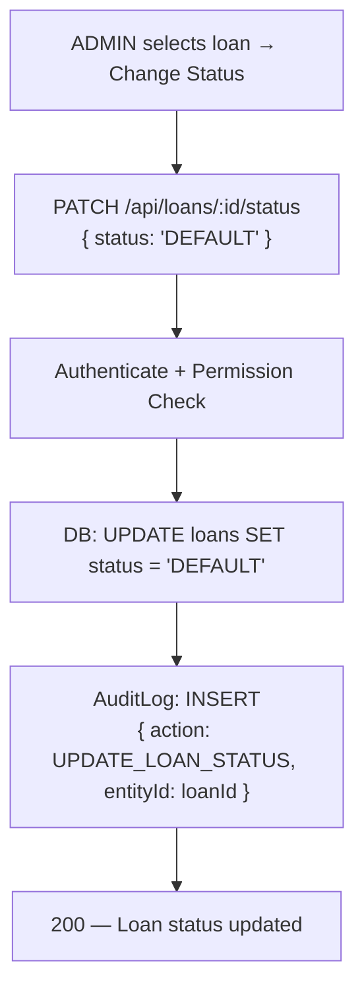

**Endpoint:** `PATCH /api/loans/:id/status`  
**Body:** `{ "status": "DEFAULT" | "ACTIVE" | "CLOSED" | "PENDING" }`

---

## 3. 💳 Payment Recording Flows

### 3.1 Record a Payment

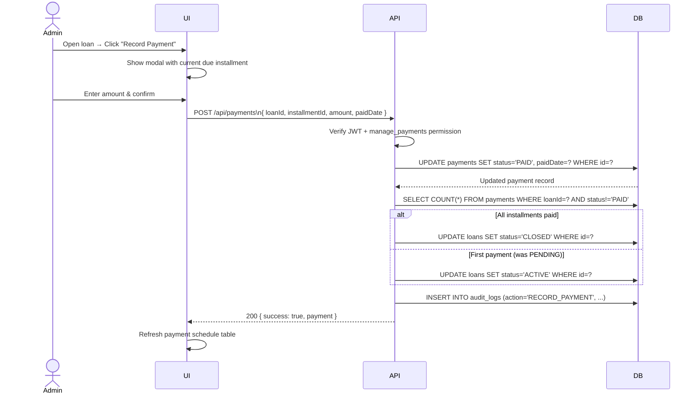

**Endpoint:** `POST /api/payments`  
**Body:**
```json
{
  "loan_id": 42,
  "amount": 12500.00,
  "paid_date": "2026-05-27"
}
```

---

### 3.2 View Payment Schedule for a Loan

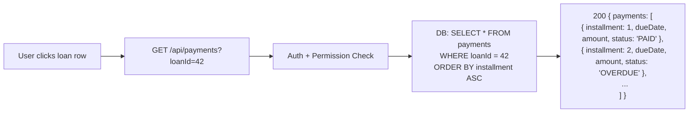

---

## 4. 📱 Mobile OTP Verification Flow

### 4.1 Standard OTP via SMS

```mermaid
flowchart TD
    A[Loan wizard: Step 2] --> B["POST /api/verify/send-otp\n{ mobile: '9876543210' }"]
    B --> C{Cooldown active?\nRedis: cooldown:{mobile}}
    C -->|Yes| D[429 — Wait 30 seconds]
    C -->|No| E[Generate 6-digit OTP]
    E --> F["Redis: SET otp:{mobile} = 123456\nTTL: 5 minutes"]
    F --> G["Redis: SET cooldown:{mobile} = timestamp\nTTL: 30 seconds"]
    G --> H[AWS SNS: SendMessage to mobile]
    H --> I[200 — OTP sent]
    I --> J[User enters OTP in UI]
    J --> K["POST /api/verify/verify-otp\n{ mobile, otp }"]
    K --> L{Redis otp:{mobile}\nmatches input?}
    L -->|No / Expired| M[400 — Invalid OTP]
    L -->|Yes| N["Redis: DELETE otp:{mobile}\nSET verified:{mobile} = uuid token\nTTL: 10 minutes"]
    N --> O[200 { verified: true, token: 'uuid' }]
    O --> P[Wizard advances to Step 3]
```

---

### 4.2 WhatsApp Fallback Verification

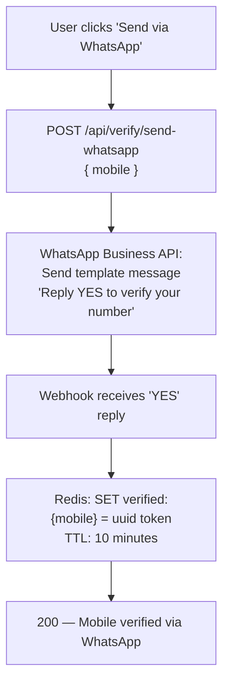

---

## 5. 📊 Dashboard & Reports Flows

### 5.1 Dashboard Metrics Load

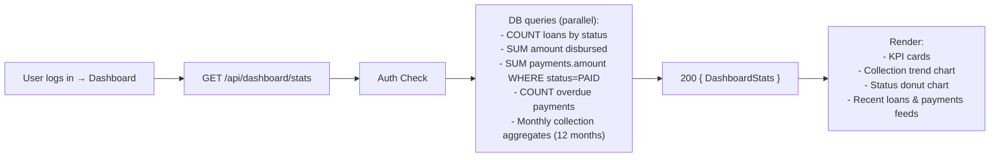

**Response Shape:**
```json
{
  "totalLoans": 142,
  "activeLoans": 87,
  "totalDisbursed": 4280000,
  "totalCollected": 2940000,
  "pendingPayments": 34,
  "overduePayments": 12,
  "monthlyCollections": [
    { "month": "2026-05", "amount": 320000 },
    { "month": "2026-04", "amount": 290000 }
  ],
  "loansByStatus": [
    { "status": "ACTIVE", "count": 87 },
    { "status": "CLOSED", "count": 43 },
    { "status": "PENDING", "count": 8 },
    { "status": "DEFAULT", "count": 4 }
  ]
}
```

---

### 5.2 View Delinquency Report

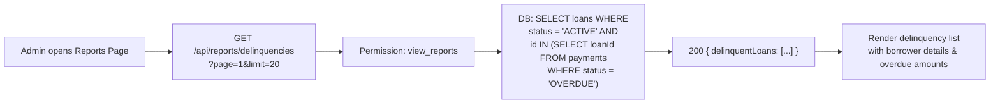

---

## 6. 📨 SMS Broadcast Flows

### 6.1 Single Borrower SMS

```mermaid
flowchart TD
    A[Admin selects one delinquent borrower] --> B[Customizes message template\n{{name}}, {{amount}}, {{due_date}}]
    B --> C["POST /api/sms/send\n{ loanId, mobile, message }"]
    C --> D[Permission: manage_loans]
    D --> E[AWS SNS: Publish to mobile]
    E --> F{Sent?}
    F -->|Success| G["DB: INSERT sms_logs { status: 'SENT' }"]
    F -->|Failure| H["DB: INSERT sms_logs { status: 'FAILED' }"]
    G & H --> I["DB: INSERT audit_logs\n{ action: SMS_BROADCAST }"]
    I --> J[200 — SMS dispatched]
```

---

### 6.2 Bulk SMS Broadcast

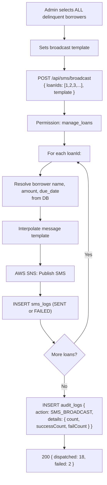

---

## 7. ⚙️ Settings & Configuration Flows

### 7.1 Update Interest Rates (SUPER_ADMIN only)

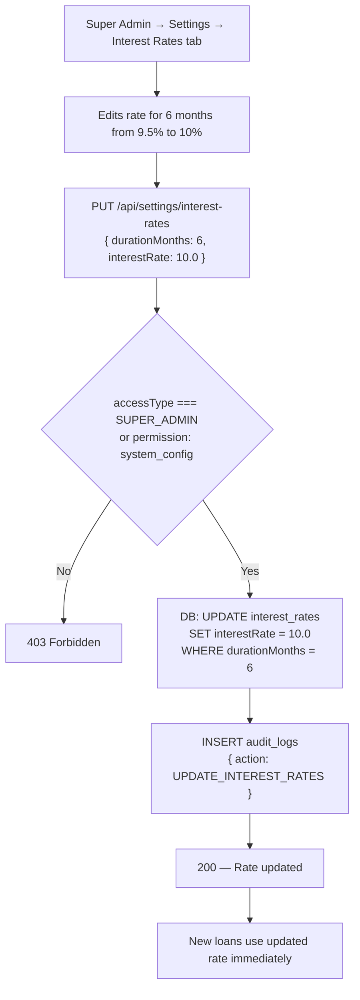

---

### 7.2 User Account Management (SUPER_ADMIN only)

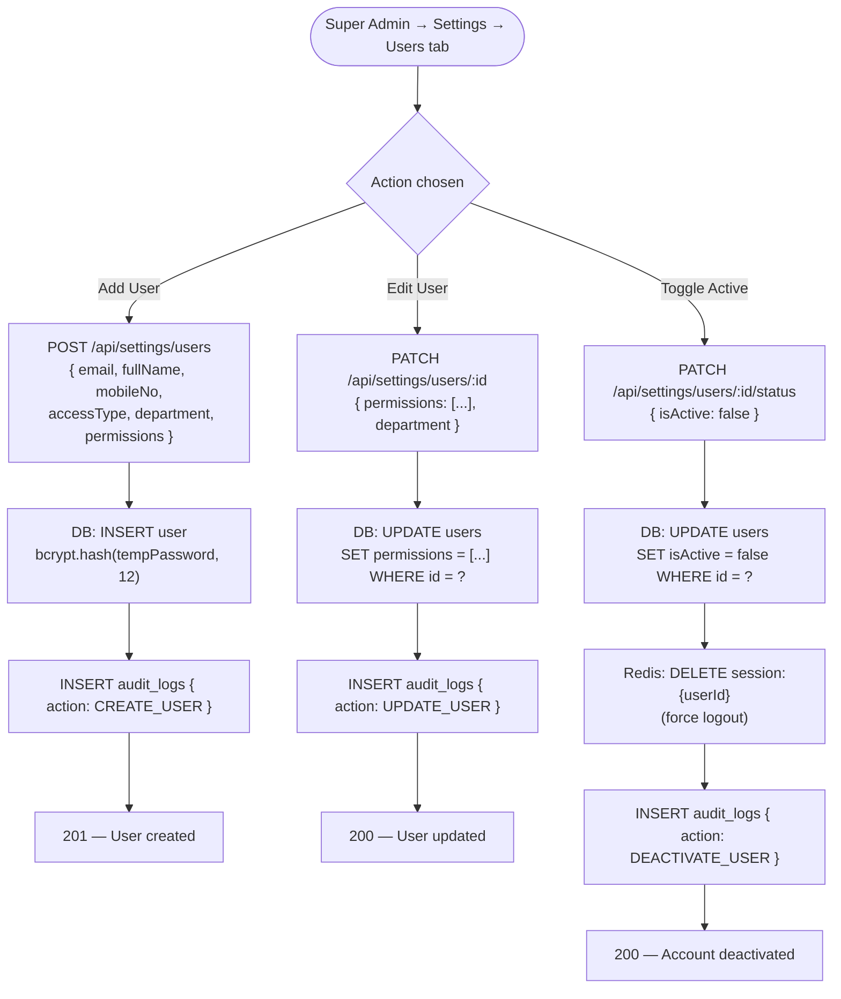

---

## 8. 📂 Data Export Flow

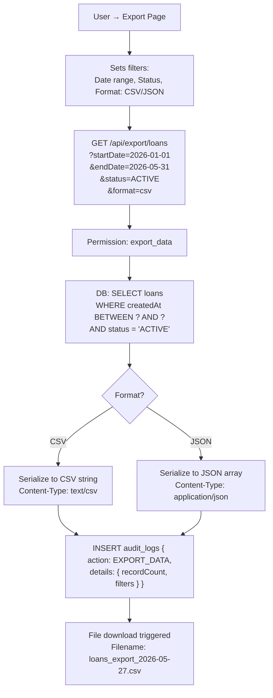

---

## 9. 📋 Audit Log View Flow

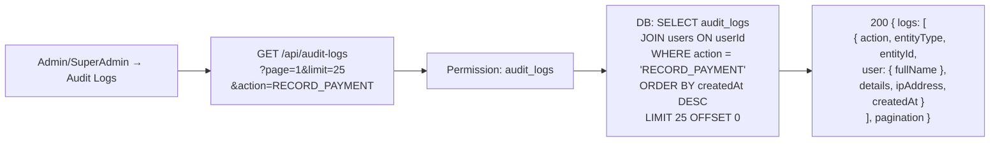

---

## 📡 Complete API Endpoint Reference

| Module | Method | Path | Permission Required | Description |
|--------|--------|------|---------------------|-------------|
| **Auth** | `POST` | `/api/auth/login` | None | User login |
| **Auth** | `POST` | `/api/auth/logout` | Authenticated | User logout |
| **Loans** | `GET` | `/api/loans` | `manage_loans` | List & search loans |
| **Loans** | `POST` | `/api/loans` | `manage_loans` | Create new loan |
| **Loans** | `GET` | `/api/loans/:id` | `manage_loans` | Get loan details |
| **Loans** | `PATCH` | `/api/loans/:id/status` | `manage_loans` | Update loan status |
| **Payments** | `GET` | `/api/payments` | `manage_payments` | List all payments |
| **Payments** | `GET` | `/api/payments?loanId=X` | `manage_payments` | Get loan installments |
| **Payments** | `POST` | `/api/payments` | `manage_payments` | Record a payment |
| **Verify** | `POST` | `/api/verify/send-otp` | `manage_loans` | Send OTP via SMS |
| **Verify** | `POST` | `/api/verify/verify-otp` | `manage_loans` | Verify OTP code |
| **Verify** | `POST` | `/api/verify/send-whatsapp` | `manage_loans` | Send WhatsApp verification |
| **SMS** | `POST` | `/api/sms/send` | `manage_loans` | Send single SMS |
| **SMS** | `POST` | `/api/sms/broadcast` | `manage_loans` | Bulk SMS broadcast |
| **Dashboard** | `GET` | `/api/dashboard/stats` | Authenticated | Fetch KPI metrics |
| **Reports** | `GET` | `/api/reports/delinquencies` | `view_reports` | Delinquent loans list |
| **Export** | `GET` | `/api/export/loans` | `export_data` | Export loans as CSV/JSON |
| **Settings** | `GET` | `/api/settings/interest-rates` | `system_config` | Get interest rate config |
| **Settings** | `PUT` | `/api/settings/interest-rates` | `system_config` | Update interest rate |
| **Settings** | `GET` | `/api/settings/users` | SUPER_ADMIN | List all users |
| **Settings** | `POST` | `/api/settings/users` | SUPER_ADMIN | Create new user |
| **Settings** | `PATCH` | `/api/settings/users/:id` | SUPER_ADMIN | Update user details |
| **Settings** | `PATCH` | `/api/settings/users/:id/status` | SUPER_ADMIN | Toggle user active state |
| **Audit** | `GET` | `/api/audit-logs` | `audit_logs` | View audit trail |

---

## 🔐 Permission Matrix

| Action | SUPER_ADMIN | ADMIN | SUB_ADMIN |
|--------|:-----------:|:-----:|:---------:|
| Login / Logout | ✅ | ✅ | ✅ |
| View Dashboard | ✅ | ✅ | ✅ |
| Create Loan | ✅ | ✅ (if permitted) | ❌ |
| View Loans | ✅ | ✅ | ✅ |
| Update Loan Status | ✅ | ✅ (if permitted) | ❌ |
| Record Payment | ✅ | ✅ (if permitted) | ✅ (if permitted) |
| Send SMS | ✅ | ✅ (if permitted) | ❌ |
| View Reports | ✅ | ✅ (if permitted) | ❌ |
| Export Data | ✅ | ✅ (if permitted) | ❌ |
| View Audit Logs | ✅ | ✅ (if permitted) | ❌ |
| Manage Interest Rates | ✅ | ❌ | ❌ |
| Create/Edit Users | ✅ | ❌ | ❌ |
| Deactivate Users | ✅ | ❌ | ❌ |
